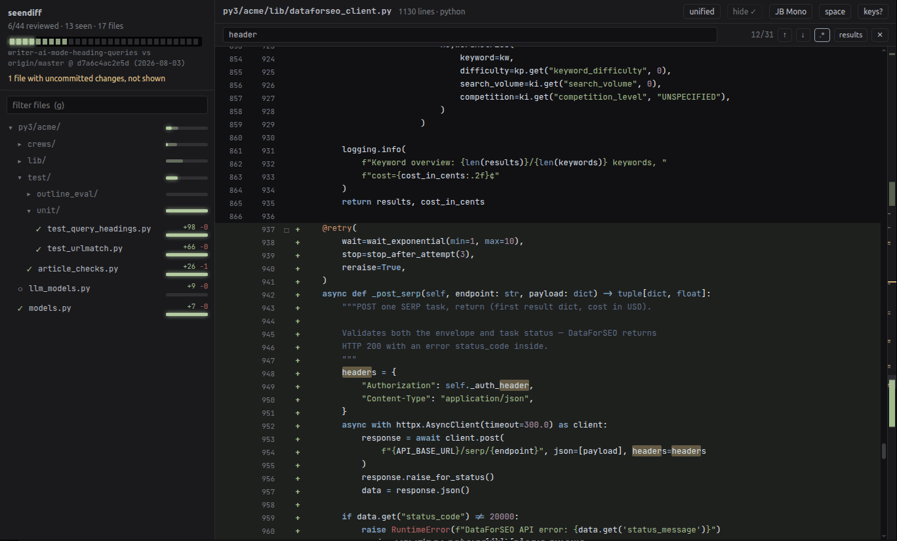
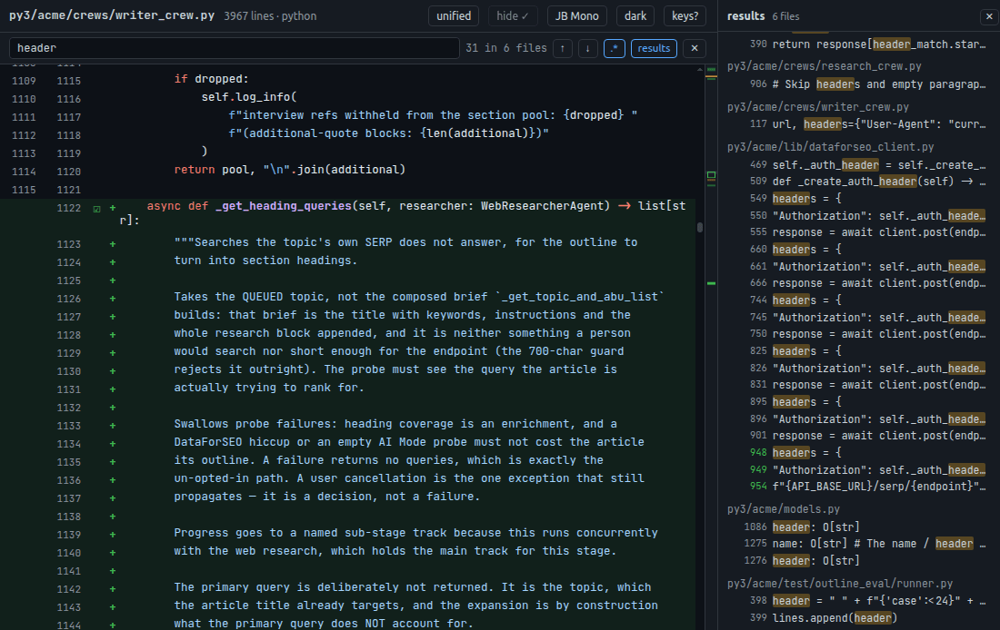

# seendiff

A local, point-in-time diff reviewer for large diffs.

View large diffs, while keeping track of what is seen and reviewed.
**Coding agent optimized.**

  

<br>

<div align="center">

# → [open the docs website](https://acme-dot-bot.github.io/seendiff/) ←


</div>

<br>



Your branch's full diff against `origin/master`, every changed file shown **whole**
rather than as hunk fragments. Review state survives closing the window, and a rebase.

Not a merge tool: no editing, no conflict resolution, no comments. It's a reader.

## Install

You need **Python ≥ 3.10** and **git**. You are installing one thing: a CLI named
`seendiff`. When it's done, `seendiff` runs from any directory, in a fresh shell, with no
virtualenv activated and no path prefix.

With [uv](https://docs.astral.sh/uv/) — it brings its own Python:

```bash
curl -LsSf https://astral.sh/uv/install.sh | sh
uv tool install git+https://github.com/acme-dot-bot/seendiff
```

With pipx:

```bash
pipx install git+https://github.com/acme-dot-bot/seendiff
```

With plain pip, into a venv you keep:

```bash
python3 -m venv ~/.venvs/seendiff
~/.venvs/seendiff/bin/pip install git+https://github.com/acme-dot-bot/seendiff
ln -s ~/.venvs/seendiff/bin/seendiff ~/.local/bin/seendiff   # this is what puts it on PATH
```

Or hand it to your coding agent:

> Install the seendiff CLI for me, from https://github.com/acme-dot-bot/seendiff — a
> Python CLI, needs Python 3.10+ and git. When you're done, `seendiff` runs from any
> directory in a fresh shell, with no virtualenv activated and no path prefix.

Four runtime dependencies: FastAPI, uvicorn, `unidiff`, Pygments. Nothing to build, no
`node_modules`, no config file, no daemon.

State lands in `~/.local/state/seendiff/state.db` (pruned after 60 days) and rendered
files cache in `~/.cache/seendiff/` (30 days). Nothing else is written outside the repo.

## Run it

From inside any git repo:

```bash
seendiff                 # HEAD vs origin/master, with fallbacks
seendiff main            # ...or any branch, tag or SHA as the base
seendiff HEAD~3          # just the last three commits
seendiff --port 8700     # a fixed port instead of a free one
```

It picks a free port, starts a localhost server and opens your browser. `Ctrl-C` to stop.

Also: `--fetch` (git fetch first — never implicit), `--clear` (drop this branch's review
state), `--no-browser`, `--no-highlight`, `--no-auto-seen`.

## Fully keyboard driven

| | |
|---|---|
| `←` `→` | previous / next change block |
| `↑` `↓` | previous / next file |
| `n` `N` | next / previous **unreviewed** block |
| `R` | toggle reviewed on the focused block, jump to next unreviewed |
| `V` | mark every *seen* block in this file reviewed |
| `f` | mark the whole file reviewed, move to the next file |
| `y` | copy a `path:line` ref for the focused block, with its content |
| `Y` | copy refs for everything still unreviewed |
| `j` `k` `d` `u` | scroll |
| `Ctrl-F` | search all changed files — `⏎`/`⇧⏎` next / previous |
| `g` | focus the file filter |
| `h` | hide fully-reviewed files |
| `t` | cycle theme &nbsp;•&nbsp; `?` help &nbsp;•&nbsp; `X` reset all state |

**Seen** happens on its own — a block scrolls through the viewport, it's seen.
**Reviewed** is always deliberate.

## Search

`Ctrl-F` searches **every changed file**, not just the open one. Hits are marked in place
as you type, keeping their syntax colour, and ticked on the minimap.



Queries are literal and smart-cased — all-lowercase matches any case, any capital makes it
case-sensitive. `.*` toggles regex. Removed lines are searchable too.

The browser's own find can't help here: the code pane is virtualized, so only the rows on
screen exist in the DOM. Whole-change search runs server-side via `/api/search`.

## Themes

`t` cycles six — **light**, **dark**, **solarized-light**, **solarized-dark**, **space**
and **hailmary** — each with a matching Pygments palette, so syntax colours change with
the chrome instead of staying bolted to one scheme.

Theme, font, layout, sidebar width and collapsed folders persist **server-side**. Every
run gets a fresh port, and browser storage is scoped per origin, so `localStorage` alone
would forget.

## Code walkthrough skill

**AI + Human > AI or Human.**

AI is a super-coder, but lacks the awareness and context to make the tradeoffs that drive
your design decisions.

Any sane codebase wants a pair of trained human eyes on it. This project was born out of
that need.

To that end, seendiff ships with a walkthrough mode — where a coding agent explains
itself, step by step, on the diff.

Ask your coding agent to install the skill, once:

> Install the seendiff skill for me, from https://github.com/acme-dot-bot/seendiff — so
> you can open diffs and write walkthroughs for me in any repo.

It's a symlink, if you'd rather do it yourself:

```bash
ln -s "$(pwd)/skills/seendiff" ~/.claude/skills/seendiff
```

Then, in any repo, ask for the walkthrough you want — *"explain the auth flow in this
PR"*.


Steps are grouped into acts, so a big change reads as a few chapters instead of eighty
bullet points. `←`/`→` step, `[`/`]` jump acts, `.` folds the detail away, `w` hides the
bar, **dismiss** returns to the plain diff.

```bash
seendiff --walkthrough .git/seendiff-walkthrough.json   # play it back
seendiff --check-walkthrough path/to/wt.json            # validate, exit 0/1
```

The script is JSON — format and rules in [`CODEWALKTHROUGH.md`](CODEWALKTHROUGH.md), with
a [worked example](examples/seendiff-review-state.json). Every line reference is checked
against the real diff before anything renders, so a stale one fails at load instead of
scrolling you somewhere wrong.

The file may be **empty** (`{}`). That's not an error: seendiff opens as a plain diff
reviewer and watches it, so an agent can write a script later and every open tab picks it
up within a couple of seconds — no relaunch, no new tab.

## Architecture

**A Python HTTP server, one hand-written HTML file, and SQLite.** That's the whole stack.
~4,000 lines of shipped code, plus ~460 of tests.

```
git ──► git.py ──────► server.py ──► static/index.html
                        │   ▲          (fetches JSON, renders)
        walkthrough.py ─┘   │
                            ▼
                        store.py ──► ~/.local/state/seendiff/state.db
```

| file | lines | what it does |
|---|---|---|
| `static/index.html` | 2326 | The entire UI: markup, CSS and vanilla JS in one file. Virtual scroller, side-by-side and unified views, canvas minimap, search, six themes, walkthrough player. |
| `server.py` | 526 | FastAPI on uvicorn, bound to `127.0.0.1`. Holds the diff in memory, recomputes only when HEAD moves, disk-caches rendered files, inlines the syntax palette into the page. |
| `git.py` | 446 | Runs `git diff` via subprocess, parses it with `unidiff`, groups hunks into **blocks**, expands submodule pointers, and reconstructs each file's *whole* post-image with every line tagged added / removed / context. |
| `walkthrough.py` | 348 | Loads and validates walkthrough scripts against the real diff. |
| `store.py` | 126 | SQLite: review state and UI preferences. Two tables, no ORM, no migrations. |
| `cli.py` | 117 | argparse → pick a free port → open a browser → `uvicorn.run`. |
| `highlight.py` | 109 | Pygments tokenization per line, with bail-outs for minified or enormous files. |

A few decisions worth knowing:

**Blocks, not hunks.** A hunk is a diff-format artifact — its boundaries move when you
change the context setting. A block is a maximal run of adjacent changed lines, with a
stable `hunk_id` derived from its content, so review state survives a rebase.

**Scope is symbolic.** State is keyed on `repo | base_ref | branch`, *not* on commit SHAs.
Amend, rebase or reword and your review state is still there.

**Diff is immutable per (merge-base, HEAD).** Computed once, cached in memory; requests
only re-stat the working tree for the dirty-files banner.

**The frontend is a virtual scroller.** Files run to tens of thousands of lines, so only
the visible rows are in the DOM. Row geometry comes from real glyph metrics, remeasured
once webfonts land — which is also what makes the canvas minimap line up.

**Server binds 127.0.0.1 and rejects any `Host` header that isn't localhost**, so a
malicious page in another tab can't reach into your source tree via DNS rebinding.

**Nothing leaves the machine.** No telemetry, no network calls, no accounts. `git fetch`
runs only when you pass `--fetch`.

[`PLAN.md`](PLAN.md) is the original build brief — motivation, rejected alternatives, and
the reasoning behind each locked decision.

## Development

```bash
python3 -m venv .venv && .venv/bin/pip install -e . pytest
.venv/bin/python -m pytest tests/ -q
```

35 tests: the walkthrough validator, the search endpoint, preference storage, and the
search-match renderer — that last one runs under `node` (skipped if you don't have it) and
pulls the functions straight out of `index.html`, so it can't drift from what ships.

## Contributing

Open an issue with a **prompt** for the feature you want — the ask, written the way you'd
hand it to an agent. That's the useful contribution here.

No pull requests, please; they won't be merged. Feel free to fork.

## License

[MIT](LICENSE).

Bundles two fonts under their own terms:
[JetBrains Mono](https://github.com/JetBrains/JetBrainsMono) (Apache-2.0) and
[Ubuntu Sans Mono](https://github.com/canonical/Ubuntu-Sans-fonts) (UFL-1.0).
