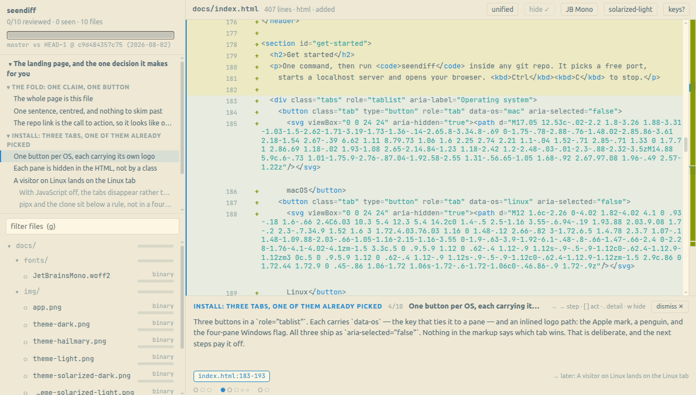

# seendiff

A local, point-in-time diff tool for large diffs.

View large diffs, while keeping track of what is seen and reviewed.
**Optimized for AI coding agents.**

  

<br>

<div align="center">

### [seendiff.com](https://seendiff.com/)


**[▶ Watch the 40-second demo](https://seendiff.com/)**

</div>

<br>

Your branch's full diff against `origin/master` — commits, staged and unstaged work,
untracked files — every changed file shown **whole** rather than as hunk fragments. The
tab follows the working tree live. Review state survives closing the window, staging,
committing, and a rebase.

Not a merge tool: no editing, no conflict resolution, no comments. It's a reader.

## Install

Needs **Python ≥ 3.10** and **git**. You're installing one CLI, `seendiff`, which then
runs from any directory in a fresh shell — no virtualenv, no path prefix.

```bash
uv tool install git+https://github.com/acme-dot-bot/seendiff     # or:
pipx install git+https://github.com/acme-dot-bot/seendiff
```

With plain pip, into a venv you keep:

```bash
python3 -m venv ~/.venvs/seendiff
~/.venvs/seendiff/bin/pip install git+https://github.com/acme-dot-bot/seendiff
ln -s ~/.venvs/seendiff/bin/seendiff ~/.local/bin/seendiff   # this is what puts it on PATH
```

Or hand it to your coding agent:

> Install the seendiff CLI for me, from https://github.com/acme-dot-bot/seendiff — a
> Python CLI, needs Python 3.10+ and git. When you're done, `seendiff` runs from any
> directory in a fresh shell, with no virtualenv activated and no path prefix.

Four dependencies: FastAPI, uvicorn, `unidiff`, Pygments. Nothing to build, no config
file, no daemon. State lives in `~/.local/state/seendiff/` (pruned after 60 days) and
`~/.cache/seendiff/` (30 days); nothing else is written outside the repo.

## Run it

From inside any git repo:

```bash
seendiff                 # working tree vs origin/master, with fallbacks
seendiff main            # ...or any branch, tag or SHA as the base
seendiff HEAD~3          # the last three commits plus anything uncommitted
seendiff --staged        # just what the next commit would contain
seendiff --port 8700     # a fixed port instead of a free one
```

It picks a free port, starts a localhost server and opens your browser. Close the tab and
it exits about two seconds later (a reload doesn't count); `--keep-running` keeps it
serving, and `Ctrl-C` always stops it. If seendiff stops while a tab is still open, the
tab closes itself where the browser allows it, and otherwise greys out and ignores input.
Start seendiff again on the same port and the tab reloads by itself.

Four views, switched in the sidebar or with `m` / `M`; each tab shows its file count:

| view | compares | flag |
|---|---|---|
| **all** (default) | base → working tree | `--mode all` |
| **commits** | base → HEAD | `--committed` |
| **staged** | HEAD → index | `--staged` |
| **unstaged** | index → working tree, untracked files included | `--unstaged` |

The open tab polls every 2 s, so edits, `git add` and commits show up without a reload;
only a file whose content changed is re-read, and it keeps its scroll position. Review
state is keyed on block content, so a block you reviewed under *unstaged* is still
reviewed once it's staged or committed. Conflicted paths are left out (it's a reader, not
a merge tool). With no `origin/master|main` or `master|main`, the base is `HEAD`.

Also `--fetch` (never implicit), `--clear` (drop this branch's review state),
`--no-untracked`, `--no-browser`, `--no-highlight`, `--no-auto-seen`,
`--section-min` / `--section-max`, and `--list-blocks` (print every block's `hunk_id`).

## Fully keyboard driven

| | |
|---|---|
| `←` `→` | previous / next change block |
| `↑` `↓` | previous / next file |
| `n` `N` | next / previous **unreviewed** block |
| `R` | toggle reviewed on the focused block, jump to next unreviewed |
| `V` | mark every *seen* block in this file reviewed |
| `f` | mark the whole file reviewed, move to the next file |
| `y` | copy a `path:line` ref for the focused block, with its content |
| `Y` | copy refs for everything still unreviewed |
| `j` `k` `d` `u` | scroll |
| `Ctrl-F` | search all changed files — `⏎`/`⇧⏎` next / previous |
| `g` | focus the file filter |
| `h` | hide fully-reviewed files |
| `m` `M` | next / previous view: all, commits, staged, unstaged |
| `c` | commit what's staged, with a proposed message |
| `t` | cycle theme &nbsp;•&nbsp; `?` help &nbsp;•&nbsp; `X` reset all state |

**Seen** happens on its own — a block scrolls through the viewport, it's seen.
**Reviewed** is always deliberate.

## Images

Changed PNG, JPEG, GIF, WebP, BMP, ICO and AVIF files show as pictures, before and after
side by side on a checkerboard, with dimensions and file size (a changed size is
highlighted). **fit / 2× / 4× / 8×** scales both sides together, pixel-sharp, for icons.
An image is one block: `R` or `f` reviews it. SVG stays a text diff, since its source is
what you'd review.

## Commit from the review

`c` (or **commit** in the top bar) commits what's **staged**, with a proposed message
you can edit first. Proposals are plain files in the repo root, one per queued change:
`COMMIT_MSG_<description>.txt`. An agent writes one, you review the diff, then pick the
proposal, edit it and press `Ctrl-⏎`. Lines starting with `#` are dropped, so a proposal
can carry notes to you. The file is deleted once committed; the others stay queued.
Edits are kept as drafts while the panel is closed, and `Ctrl-S` writes them back to the
file. A proposal that changed on disk since you opened it is never overwritten or
committed. seendiff leaves these files out of its diffs. Hooks run as usual, and a
failing hook's output is shown in the panel.

Outside seendiff, `git cm` does the same from a terminal. It's installed with seendiff
(a `git-cm` console script, which git finds as `git cm`). It opens the proposal in your
editor; `git cm <word>` picks one when several are waiting, and `git cm -l` lists them.
For agents,
[`contrib/claude-commit-rule.md`](contrib/claude-commit-rule.md) is a rule to add to
`~/.claude/CLAUDE.md` so every session proposes messages this way.

## Search

`Ctrl-F` searches **every changed file**, not just the open one. Hits are marked in place
as you type, keeping their syntax colour, and ticked on the minimap.


Queries are literal and smart-cased — all-lowercase matches any case, any capital makes it
case-sensitive. `.*` toggles regex. Removed lines are searchable too. The browser's own
find can't help: the code pane is virtualized, so only on-screen rows exist in the DOM.

## Themes

`t` cycles six — **light**, **dark**, **solarized-light**, **solarized-dark**, **space**,
**hailmary** — each with a matching Pygments palette, so syntax colours change with the
chrome. Theme, font, layout and sidebar width persist server-side, because every run gets
a fresh port and `localStorage` is scoped per origin.

## Code walkthrough skill

**AI + Human > AI or Human.** So seendiff ships with a walkthrough mode, where a coding
agent explains its change step by step, on the diff.



Ask your coding agent to install the skill, once:

> Install the seendiff skill for me, from https://github.com/acme-dot-bot/seendiff — so
> you can open diffs and write walkthroughs for me in any repo.

It's a symlink, if you'd rather: `ln -s "$(pwd)/skills/seendiff" ~/.claude/skills/seendiff`

Then, in any repo, ask for what you want — *"explain this PR using a code walkthrough"*.
Steps group into acts, so a big change reads as a few chapters. `←`/`→` step, `[`/`]`
jump acts, `.` folds the detail, `w` hides the bar, **dismiss** returns to the plain diff.

```bash
seendiff --walkthrough .git/seendiff-walkthrough.json   # play it back
seendiff --list-blocks                                  # hunk_ids for change refs
seendiff --check-walkthrough path/to/wt.json            # validate, exit 0/1
```

The script is JSON — format in [`CODEWALKTHROUGH.md`](CODEWALKTHROUGH.md), with a
[worked example](examples/seendiff-review-state.json). Every line reference is checked
against the real diff before rendering, so a stale one fails at load instead of scrolling
you somewhere wrong. An empty file (`{}`) is fine: seendiff opens as a plain diff tool and
watches it, so an agent can write the script later and open tabs pick it up in seconds.

## Architecture

**A Python HTTP server, one hand-written HTML file, and SQLite.** ~4,000 lines shipped,
plus ~460 of tests.

```
git ──► git.py ──────► server.py ──► static/index.html
                        │   ▲          (fetches JSON, renders)
        walkthrough.py ─┘   │
                            ▼
                        store.py ──► ~/.local/state/seendiff/state.db
```

| file | lines | what it does |
|---|---|---|
| `static/index.html` | 2326 | The whole UI in one file: virtual scroller, side-by-side and unified views, canvas minimap, search, themes, walkthrough player. |
| `server.py` | 526 | FastAPI on uvicorn, bound to `127.0.0.1`. Diff in memory, recomputed only when HEAD moves. |
| `git.py` | 446 | Runs `git diff`, parses with `unidiff`, groups hunks into **blocks**, rebuilds each file's whole post-image. |
| `walkthrough.py` | 348 | Loads and validates walkthrough scripts against the real diff. |
| `store.py` | 126 | SQLite: review state and preferences. Two tables, no ORM, no migrations. |
| `cli.py` | 117 | argparse → free port → browser → `uvicorn.run`. |
| `highlight.py` | 109 | Pygments per line, with bail-outs for minified or enormous files. |

**Blocks, not hunks.** Hunk boundaries move with the context setting. A block is a maximal
run of adjacent changed lines with a content-derived `hunk_id`, so review state survives a
rebase. Blocks over `--section-max` lines (48) split into sections of at least
`--section-min` (12), cut at a seam — removed-to-added turn, blank line, unindented
declaration — so editing one section costs only that section's state.

**Scope is symbolic.** State is keyed on `repo | base_ref | branch`, not commit SHAs.
Amend, rebase or reword and it's still there.

**The bar is weighted by lines, not blocks** — a two-line fix and a two-hundred-line
rewrite are both one block. The counter still reads in blocks, because that's what you
act on.

**Nothing leaves the machine.** No telemetry, no accounts. The server binds 127.0.0.1 and
rejects any `Host` that isn't localhost, so another tab can't reach your source tree via
DNS rebinding. `git fetch` runs only with `--fetch`.

[`PLAN.md`](PLAN.md) is the original build brief — motivation, rejected alternatives, and
the reasoning behind each locked decision.

## Personal Arch package

[`packaging/arch/`](packaging/arch/PKGBUILD) builds `seendiff-local` from this checkout's
committed HEAD, replacing the AUR's `seendiff-git` (which builds upstream):

```bash
cd packaging/arch && makepkg -si
```

## Development

```bash
python3 -m venv .venv && .venv/bin/pip install -e . pytest
.venv/bin/python -m pytest tests/ -q
```

35 tests. The search-match renderer test runs under `node` (skipped if absent) and pulls
the functions straight out of `index.html`, so it can't drift from what ships.

## Contributing

**Bugs** — file an issue with what makes it reproducible: OS, environment, the exact
failure, logs. **Features** — write them as prompts to an LLM. **Customizations** — fork it.

## License

[MIT](LICENSE). Bundles [JetBrains Mono](https://github.com/JetBrains/JetBrainsMono)
(Apache-2.0) and [Ubuntu Sans Mono](https://github.com/canonical/Ubuntu-Sans-fonts)
(UFL-1.0) under their own terms.
